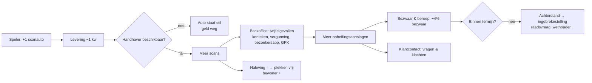
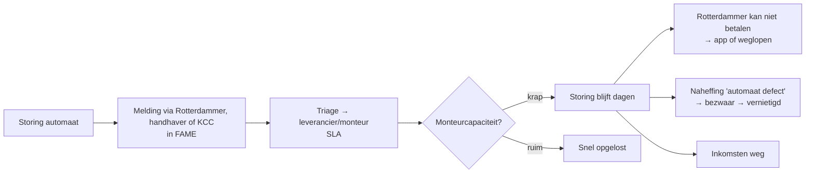
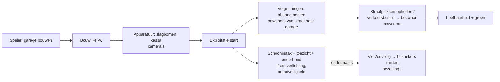
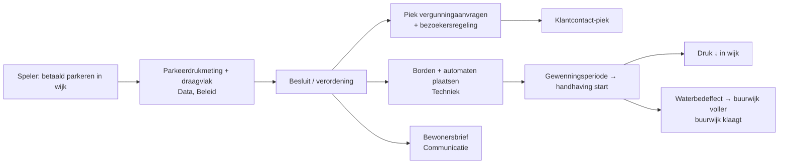
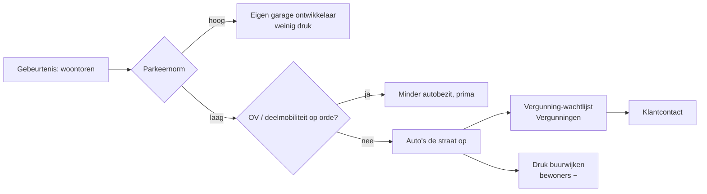
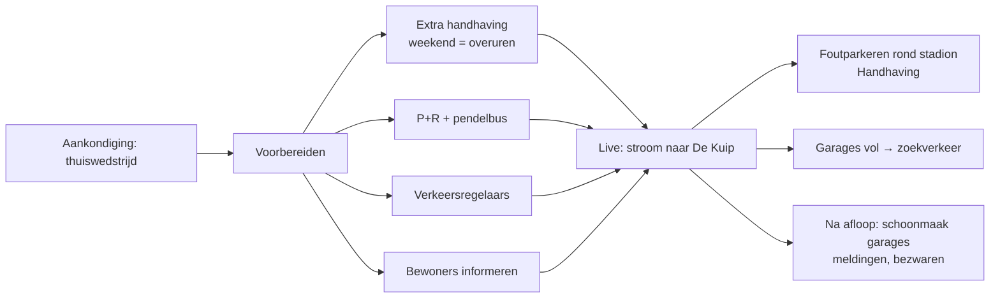
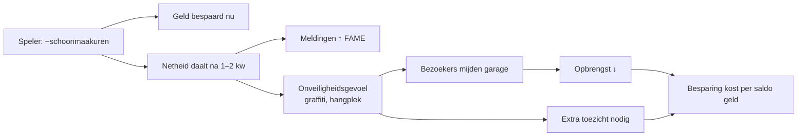
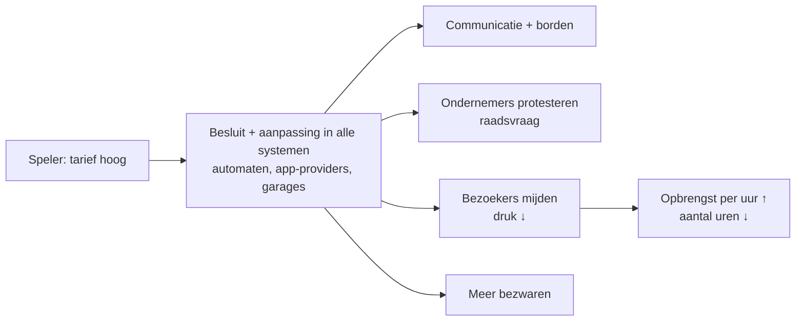

# Ketens — hoe één keuze door de afdeling rolt

Status: concept v0.1 voor validatie door Robert. ❓ = check met het vak: klopt dit voor Rotterdam?
Doel: in het spel ziet de speler na een keuze de **kettingreactie** (animatie langs teams) en de **werkdruk per team** oplopen. Dit is de kern van "elkaars werk begrijpen". Klopt een keten niet, dan ondermijnt dat het hele spel — daarom eerst hier valideren.

## Teams in het spel (personages)

| team | wat ze in het spel doen | werkdruk loopt op door |
|---|---|---|
| Beleid & bestuur | besluiten, verordening, raadsvragen | invoering betaald parkeren, tariefwijziging, incidenten |
| Handhaving (straat) | scanauto rijden, controleren | meer scanauto's, evenementen |
| Backoffice handhaving | scans beoordelen, naheffingsaanslagen | meer scans, twijfelgevallen |
| Bezwaar & beroep | bezwaren afhandelen binnen wettelijke termijn | meer naheffingen, storingen, invoering |
| Klantcontact | telefoon, mail, chat | elke verandering die burgers raakt |
| Vergunningen | bewoners-, bedrijfs-, bezoekersregeling | nieuwe betaalde wijk, nieuwbouw, garage-abonnementen |
| Techniek & onderhoud | automaten, slagbomen, liften, verlichting (deels via leveranciers) | meer assets, storingen |
| Garagebeheer & schoonmaak | exploitatie, toezicht, netheid | meer garages/stallingen, evenementen |
| Data & informatie | parkeerdruk meten, monitoren | (ondersteunend) |
| Communicatie | bewonersbrieven, borden, campagnes | invoering, evenementen |

❓ Mist er een team, of zijn er teams die in het echt samen één team zijn?

---

## K1. Extra scanauto

- **Les:** handhaving zonder backoffice en bezwaar is een lek emmer.
- ❓ Welk deel van de scans vraagt handmatige beoordeling, ongeveer?
- ❓ Bezwaarpercentage en doorlooptijd: welke orde van grootte is realistisch?

## K2. Betaalautomaat kapot

- **Les:** minder monteurs scheelt geld op papier en kost meer via bezwaren en derving. Hoe groter het aandeel app-betalers, hoe kleiner de schade.
- ❓ Doen jullie monteurs dit zelf, of loopt het via leverancierscontracten (zoals Flowbird)? In dat laatste geval wordt het in het spel "contract-SLA kopen" in plaats van "monteur aannemen".

## K3. Garage bouwen

- **Les:** de bouw is het begin. Het straatplekken-voordeel komt pas na een verkeersbesluit, met vertraging en weerstand.
- ❓ Hoe lang duurt een verkeersbesluit voor het opheffen van straatplekken realistisch, inclusief bezwaar?

## K4. Betaald parkeren invoeren in een wijk

- **Les:** één maatregel raakt zes teams en de buurwijk.
- ❓ Werken jullie met een draagvlakmeting of enquête als harde voorwaarde? Zo ja, dan wordt dat in het spel een stap die kan mislukken.

## K5. Nieuwe woontoren (groei)

- **Les:** een lage parkeernorm werkt alleen met alternatieven. Anders schuif je het probleem door naar Parkeren.
- ❓ Heeft Parkeren in het echt invloed op de parkeernorm, of krijg je die als voldongen feit? Dat bepaalt of het een knop of een gebeurtenis wordt.

## K6. Evenement: Feyenoord speelt thuis

- **Les:** een evenement is vooral voorbereiding, en de voorbereiding kan alleen met mensen en assets die je al hebt.
- ❓ Wie organiseert dit in het echt? Waar houdt Parkeren op en begint evenementen, verkeer of de politie?

## K7. Bezuinigen op schoonmaak

- **Les:** bezuinigen op beheer is uitstel, geen afstel.

## K8. Tarief verhogen

- **Les:** de tariefknop werkt, maar verschuift het probleem naar ondernemers en bestuur.
- ❓ Hoe vaak mag het tarief in het echt wijzigen (begrotingscyclus)? In het spel nu maximaal één keer per jaar per wijk.

---

## Hoe het in het spel zichtbaar wordt

- **Kettingreactie-animatie:** na de keuze lichten de teampersonages één voor één op langs de keten, met een vertragingsklokje per stap. Je kunt het overslaan, maar de eerste keer speelt het altijd.
- **Werkdrukmeter per team:** groen, oranje, rood. Bij rood gaan de personages zweten, geeft hun uitspraak een signaal ("We lopen 3 weken achter met bezwaren") en lekt het effect door naar de volgende stap in de keten.
- **Nabespreking:** "Jouw spel in ketens". Per team de piek in werkdruk en welke keuze die veroorzaakte.

## In het rekenmodel (fase 4)
Nieuwe toestand per team: `capaciteit`, `werkvoorraad`, `achterstand`. Elke keten = een lijst stappen `{team, werkPerEenheid, vertragingKw}`. Achterstand verlaagt de effectiviteit van de volgende stap en drukt Rotterdammert- en wethouderscores. Getallen in `config.json`, ketens in `data/ketens.json`.
